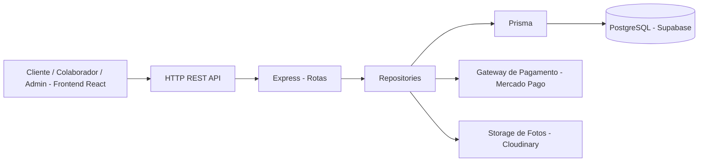
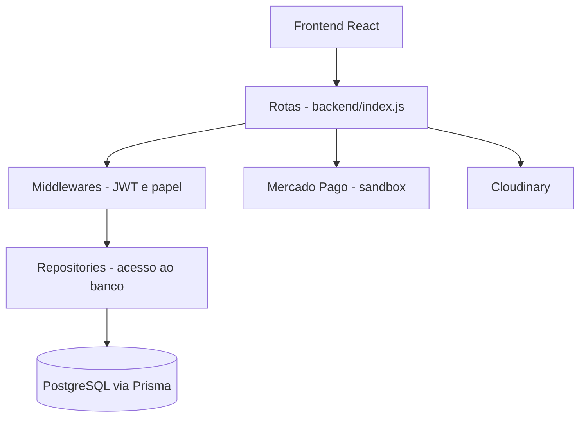
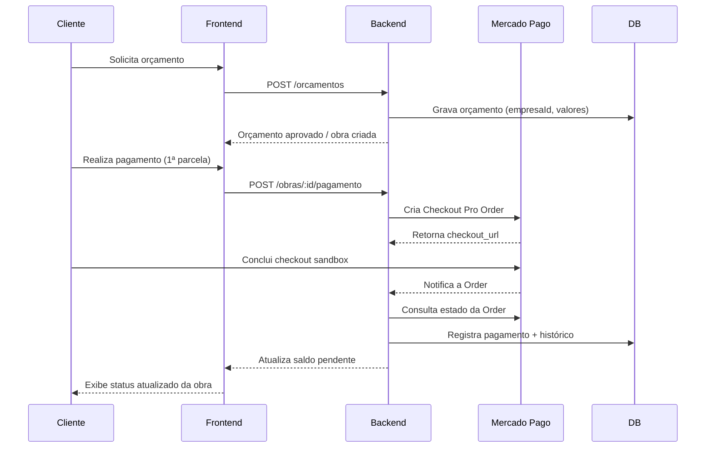
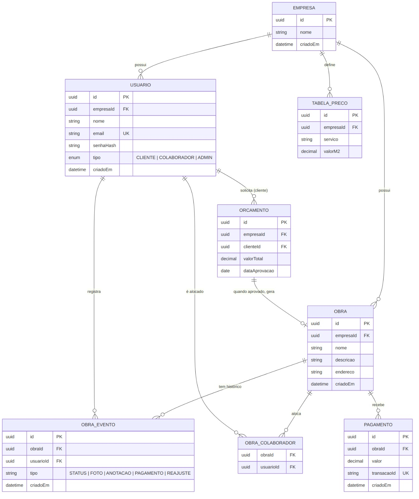

# 🏗️ ObraMaster — Gestão de Obras para Pequenas Empresas

[](#-testes)

## 🚀 Modernizando a gestão de obras com uma plataforma centralizada

### Transforme cadernos, planilhas e grupos de WhatsApp em um histórico único, auditável e acessível para todos os envolvidos na obra.

     -00B1EA?style=for-the-badge)

---

# 🛠️ Início rápido (desenvolvimento)

Pré-requisitos:
- Node.js 20+
- Conta no Supabase (banco PostgreSQL já hospedado na nuvem)
- Conta sandbox no Mercado Pago para validar pagamentos (integração implementada; aprovação real ainda depende de credenciais e webhook público)

**Backend** (Node.js + Express):
```
cd backend
npm install
cp .env.example .env     # depois preencha DATABASE_URL, DIRECT_URL e JWT_SECRET
npm run dev              # desenvolvimento (reinicia ao salvar)
```
Para rodar sem reinício automático, use `npm start`. Por padrão, a API sobe em `http://localhost:3000` (ou na porta definida em `PORT`). O `npm install` já executa `prisma generate` automaticamente.

Para conferir se a conexão com o banco está funcionando:
```
cd backend
npm run test-connection
```
Contrato das rotas atualmente implementadas: [`docs/api-contract.md`](docs/api-contract.md).

**Configuração de Ambiente (.env)**:
O backend usa a string de conexão do banco (Supabase), o segredo do JWT e, quando habilitadas, as credenciais de integrações. O arquivo `backend/.env.example` lista as variáveis sem valores secretos:

| Variável | Para que serve |
|---|---|
| `PORT` | Porta da API (padrão: `3000`) |
| `DATABASE_URL` | Connection string do PostgreSQL no Supabase (pooler transaction, porta `6543`) para a API |
| `DIRECT_URL` | Connection string direta ou pooler session (porta `5432`) usada pelo Prisma Migrate |
| `JWT_SECRET` | Segredo usado para assinar os tokens de login (validade de 8h) |
| `CLOUDINARY_CLOUD_NAME`, `CLOUDINARY_API_KEY`, `CLOUDINARY_API_SECRET` | Upload de fotos da obra |
| `MERCADO_PAGO_ACCESS_TOKEN_TEST`, `MERCADO_PAGO_WEBHOOK_SECRET` | Checkout e confirmação de pagamentos de teste |

- **Frontend**: as telas de Login e Perfil já consomem a API. Em desenvolvimento, o Vite encaminha `/api` para `http://localhost:3000` (ver `frontend/vite.config.js`), então não é preciso configurar nada se o backend estiver rodando localmente. Para apontar para outra API, defina `VITE_API_URL` em `frontend/.env` (padrão: `/api`).

**Banco de dados** (migrations):
```
cd backend
npx prisma migrate deploy
```
Configure `DIRECT_URL` com a conexão direta ou o pooler session do Supabase antes de executar. A API continua usando `DATABASE_URL`; o Prisma Migrate usa `DIRECT_URL` para evitar o pooler transaction. Migrations existentes estão em `backend/prisma/migrations/`.

### Acessos de demonstração

As contas abaixo pertencem à empresa **Empresa Demo** e usam a senha `Demo@12345`:

| Perfil | E-mail | Senha |
|---|---|---|
| ADMIN | `admin@obramaster.demo` | `Demo@12345` |
| CLIENTE | `cliente@obramaster.demo` | `Demo@12345` |
| COLABORADOR | `colaborador@obramaster.demo` | `Demo@12345` |

A tela de Login tem atalhos para ADMIN, CLIENTE e COLABORADOR. O seed cria esses três usuários de demonstração e seus dados de exemplo.

> **Aviso:** crie essas contas somente em um banco isolado de demonstração. As credenciais são públicas e não devem ser usadas em produção. O seed exige `OBRAMASTER_DEMO_SEED=true` e se recusa a rodar quando `NODE_ENV=production`.

Para criar ou redefinir as contas:
```
cd backend && OBRAMASTER_DEMO_SEED=true npx prisma db seed
```
Use esse comando somente com `DATABASE_URL` apontando para um banco descartável de demonstração, nunca para o banco compartilhado ou de produção.

**Frontend** (Vite + React):
```
cd frontend
npm install
npm run dev -- --host
```
Outros scripts: `npm run build` (build de produção), `npm run lint` e `npm run preview`.
TailwindCSS já está instalado e configurado no frontend.

**Testes** (backend):
```
cd backend
npm test
```
`npm test` executa testes mockados e não acessa o banco. O teste de troca de senha é uma verificação de integração separada e cria registros temporários; execute-o somente com um banco isolado de testes. O frontend tem testes Node nas pastas `frontend/tests`.

---

# 📌 Sobre o Projeto

**ObraMaster** é uma plataforma web multiempresa (SaaS) de gestão de obras, voltada para pequenas empresas de construção e reforma que hoje controlam tudo manualmente.

> 🎯 **Estado atual**: escopo, casos de uso, regras de negócio e arquitetura definidos; backend com autenticação (login, usuário logado, troca de senha), cadastro de colaboradores e obras básicas; frontend com Login e Perfil conectados à API real e um painel provisório para o Colaborador (ainda sem funcionalidades).

## 🎯 Problema Resolvido

### Antes:
- Cadernos e planilhas soltas
- Combinados feitos só por WhatsApp
- Cliente sem visibilidade da obra
- Cobrança e reajustes sem registro formal
- Conflitos de agenda por falta de controle

### Depois:
- Histórico único e auditável por obra
- Fotos e atualizações de andamento em tempo real
- Pagamento parcelado dentro do próprio app
- Comprovante gerado a partir do histórico registrado
- Validação automática de conflito de agendamento

---

# 🌟 Funcionalidades do MVP

## Disponível
- Cliente consulta suas obras, acompanha status e histórico filtrado por visibilidade, confirma conclusão e inicia checkout de pagamento.
- Colaborador vê apenas obras alocadas e registra andamento textual ou com foto.
- Admin cria obras, aloca e encerra escalas, consulta histórico de equipe, reagenda obras, registra andamento e solicita conferência de conclusão.
- Pagamentos usam Checkout Pro Orders em sandbox; parcela só é quitada após webhook assinado e confirmação consultada no provedor.

## Ainda fora do MVP integrado
- Convites/cadastro self-service de cliente, tabela de preços e calendário consolidado.
- Gestão dedicada de funcionários, tela administrativa completa da obra, contrato demonstrativo em PDF e auditoria/notificações para todos os eventos.
- Teste real do checkout depende de credenciais sandbox e webhook HTTPS público; upload de foto depende de credenciais Cloudinary.

---

# 🧠 Arquitetura do Sistema



---

# 🏗️ Arquitetura em Camadas



---

# 📂 Estrutura de Pastas

```
gestao-de-obras/
│
├── frontend/
│   ├── src/
│   │   ├── pages/          (Login, Perfil, DashboardPlaceholder)
│   │   ├── components/     (Button, Card, Input, Modal)
│   │   ├── services/       (auth.js — chamadas à API e sessão)
│   │   ├── routes/         (dashboardRoutes.js — destino por papel)
│   │   ├── config/         (demo.js — contas de demonstração)
│   │   └── assets/
│   └── vite.config.js      (proxy /api → localhost:3000)
│
├── backend/
│   ├── index.js            (servidor Express e todas as rotas)
│   ├── src/
│   │   ├── repositories/
│   │   ├── middlewares/    (authMiddleware, exigirPapel)
│   │   └── config/         (db.js — cliente Prisma)
│   ├── prisma/
│   │   ├── schema.prisma
│   │   ├── migrations/
│   │   └── seed.js
│   ├── scripts/            (test-db.js)
│   ├── tests/              (trocaSenha.test.js)
│   └── .env.example
│
└── docs/
    ├── api-contract.md
    ├── MER-ObraMaster.jpeg
    └── Diagrama-Arquitetura-ObraMaster.jpeg
```

---

# ⚙️ Stack Tecnológica

## 🎨 Frontend
- React 19 + Vite
- TailwindCSS 3
- React Router 7 com rotas protegidas por perfil

## 🛠️ Backend
- Node.js + Express 5
- Prisma ORM v6
- JWT (autenticação, token válido por 8h)
- Bcrypt (hash de senha)
- Testes com o runner nativo do Node (`node --test`)

## 🗄️ Banco de Dados
- PostgreSQL (hospedado no Supabase)
- Modelagem multiempresa (`empresaId` em toda tabela relevante)
- Migrations via Prisma

## 💳 Integrações
- Mercado Pago Checkout Pro Orders API em sandbox. O endpoint inicia checkout; a confirmação depende de webhook assinado consultado no provedor. Ver configuração e limitações em [`docs/api-contract.md`](docs/api-contract.md).
- Cloudinary (armazenamento de fotos/arquivos)

---

# 🔁 Fluxo Principal do Sistema (visão planejada)



---

# 📋 Regras de Negócio

- **RN1** — Pagamento só é registrado se valor ≤ saldo pendente; sem duplicidade de transação
- **RN2** — Status segue sequência obrigatória Agendada → Em andamento → Concluída, sem retrocesso; só o Admin oficializa a mudança
- **RN3** — Reagendamento só é confirmado se não houver conflito de data/hora com outra obra
- **RN4** — Toda alteração (status, pagamento, agendamento) é registrada em histórico com usuário e data/hora
- **RN6** — Obra não pode ser marcada como "Concluída" com pagamento pendente
- **RN7** — Alteração de status ou agendamento dispara notificação automática ao cliente
- **RN8** — Pagamento padrão dividido em 2 parcelas: 50% na aprovação do orçamento, 50% na conclusão da obra
- **RN9** — Isolamento total de dados entre empresas (multiempresa)

> RN1 é aplicada pelo endpoint de pagamento. RN3 é validada no endpoint de reagendamento por intervalos completos da mesma empresa, e RN7 registra confirmação visível ao cliente na timeline. As demais regras ainda dependem de funcionalidades próprias.

---

# 🗃️ Modelagem de Dados

O schema Prisma e as migrations versionadas incluem empresa, usuários, obras, funcionários, escalas históricas, eventos, parcelas, tentativas de pagamento, contratos, aceites e tabelas de preço. O MER está em [`docs/MER-ObraMaster.jpeg`](docs/MER-ObraMaster.jpeg); confira o estado das migrations antes de aplicá-las em um banco.

## 🗺️ MER
O diagrama abaixo mostra o modelo completo (as tabelas implementadas e as planejadas):



---

# 🌐 Endpoints da API

> O arquivo [`docs/api-contract.md`](docs/api-contract.md) descreve o contrato atual das rotas implementadas e suas limitações.

## ✅ Implementados
```
GET   /                          (hello world do backend)
GET   /health                    (servidor ativo e presença de DATABASE_URL)
POST  /auth/login                (login com e-mail/senha, retorna JWT)
GET   /auth/me                   (dados do usuário autenticado — protegida)
GET   /usuarios                  (lista usuários da empresa — protegida)
PATCH /usuarios/me/senha         (troca da própria senha — protegida)
POST  /colaboradores             (cadastra colaborador — ADMIN)
POST  /obras                     (cria obra na empresa do token — ADMIN)
GET   /obras                     (lista obras da empresa — protegida)
GET   /obras/:id                 (detalhe da obra, filtrado por empresa — protegida)
PATCH /obras/:id/agendamento    (reagenda obra sem conflito — ADMIN; evento na timeline do cliente)
POST  /obras/:id/andamento       (texto/foto — Colaborador alocado ou ADMIN; foto via Cloudinary)
POST  /obras/:id/pagamento       (checkout sandbox — Cliente proprietário; confirmação por webhook)
POST  /obras/:id/pagamentos/:pagamentoId/retomar (retoma checkout pendente)
POST  /obras/:id/colaboradores   (aloca colaborador — ADMIN)
GET   /obras/:id/colaboradores   (alocações abertas e histórico — ADMIN)
PATCH /obras/:id/colaboradores/:alocacaoId (encerra escala — ADMIN)
POST  /obras/:id/conclusao/solicitar (ADMIN envia para conferência)
POST  /obras/:id/conclusao/confirmar (CLIENTE proprietário confirma)
POST  /webhooks/mercado-pago     (notificação de Order assinada; consulta estado oficial no provedor)
```

## 🔜 Planejados
```
POST  /auth/register             (cadastro de empresa + admin)
GET   /precos
POST  /precos
GET   /agenda
```

---

# 🔐 Segurança

## ✅ Implementado
- Autenticação via JWT (token com validade de 8h)
- Hash de senha com Bcrypt
- Rotas privadas protegidas por middleware de autenticação
- Controle por papel (`exigirPapel`) nas rotas administrativas e de cliente
- Isolamento multiempresa por `empresaId` autenticado; colaboradores só consultam obras com escala aberta

## 🔜 Pendências
- Revisão de segurança e isolamento ponta a ponta com banco de teste.
- HTTPS e gestão de segredos são responsabilidade do ambiente de implantação.
- O sistema não recebe nem armazena dados de cartão; pagamentos passam pelo gateway.

---

# 🧪 Testes

```
cd backend
npm test
```
- `backend npm test`: testes mockados de alocação, andamento, autenticação, agendamento, pagamentos e upload de fotos; não usa `DATABASE_URL`.
- `frontend node --test tests/*.test.js`: testes de integração dos serviços e utilitários do cliente.
- `backend/tests/trocaSenha.test.js` cria registros temporários e requer um banco isolado. Não execute contra desenvolvimento compartilhado ou produção.
- A aprovação real do pagamento ainda depende de credenciais sandbox e de uma URL HTTPS pública para o webhook.
- Ainda não há pipeline de CI no repositório — por isso o selo no topo continua como "pending setup".
- Passos de ambiente e teste manual: [`docs/como-testar.md`](docs/como-testar.md). Estado e limites do MVP: [`docs/escopo-do-projeto.md`](docs/escopo-do-projeto.md).

---

# 📈 Roadmap

## ✏️ Fundação do Projeto
- [x] Definição de escopo e visão do produto
- [x] Especificação de casos de uso e regras de negócio
- [x] Modelagem inicial de dados (Empresa, Usuário, Obra)
- [x] Estrutura de pastas frontend/backend
- [x] Documentação: contrato de API, MER e diagrama de arquitetura
- [x] Seed com contas de demonstração (ADMIN e CLIENTE)

## 🔨 Fase 1: MVP
- [x] Login (e-mail/senha) com JWT
- [x] Endpoint de troca de senha
- [x] Cadastro de colaboradores e obras básicas (nome, descrição, endereço) restritos a ADMIN
- [x] Frontend: telas de Login e Perfil conectadas à API real
- [ ] Frontend: integração parcial por perfil (Cliente e Colaborador usam a API; painel Admin ainda é demonstrativo; convite e recuperação de senha não estão disponíveis)
- [ ] Cadastro de empresa + admin (`/auth/register`)
- [ ] Tabela de preços por empresa
- [ ] Gestão completa de obras (status, datas, valor)
- [ ] Calendário/agenda consolidada
- [ ] Registro de andamento com texto/foto por Colaborador alocado ou ADMIN (código pronto; upload real depende de Cloudinary configurado)
- [x] Alocação de colaboradores por obra via API, com histórico de escala
- [ ] Pagamento parcelado (50/50) via PIX/cartão — endpoint e confirmação por webhook implementados; aprovação real no sandbox pendente de credenciais e configuração
- [x] Acompanhamento de obra pelo Cliente com timeline filtrada e rota de andamento
- [ ] Histórico/log de auditoria
- [ ] Testes de isolamento entre empresas, testes de frontend e CI

> O endpoint de andamento aceita colaborador alocado ou ADMIN. Fotos JPG/PNG/WebP de até 5 MB são armazenadas no Cloudinary quando suas credenciais estão configuradas no ambiente; veja [`docs/api-contract.md`](docs/api-contract.md).

## 🚀 Fase 2: Melhorias (pós-entrega)
- [ ] Chat direto entre dono e cliente
- [ ] Avaliação do serviço prestado
- [ ] Emissão de comprovante/termo em PDF
- [ ] Exportação de relatórios financeiros (PDF/Excel)
- [ ] Tela dedicada de gestão de colaboradores

---

# 🎨 Diferenciais

### Multiempresa
Qualquer empresa de obras pode usar, com dados isolados das demais

### Histórico confiável
Toda alteração registrada com usuário e data/hora — serve como comprovante

### Pensado para o dia a dia da obra
Fotos, anotações e agenda no lugar do caderno e do WhatsApp

### Mobile-first
Feito pra ser usado no celular, direto do canteiro de obras

---

# 🤝 Contribuição

- Componentização e separação em camadas (rotas / repositories / middlewares)
- Commits organizados por feature
- Pull Requests com pelo menos 1 revisão antes do merge

---

# 📜 Licença

Este projeto é acadêmico (TCC) e pode ser adaptado para fins educacionais, comerciais ou evolutivos conforme necessidade.

---

# 🏗️ ObraMaster

### Simples para a sua empresa. Transparente para o seu cliente.

## "Sua obra merece mais que um caderno."
